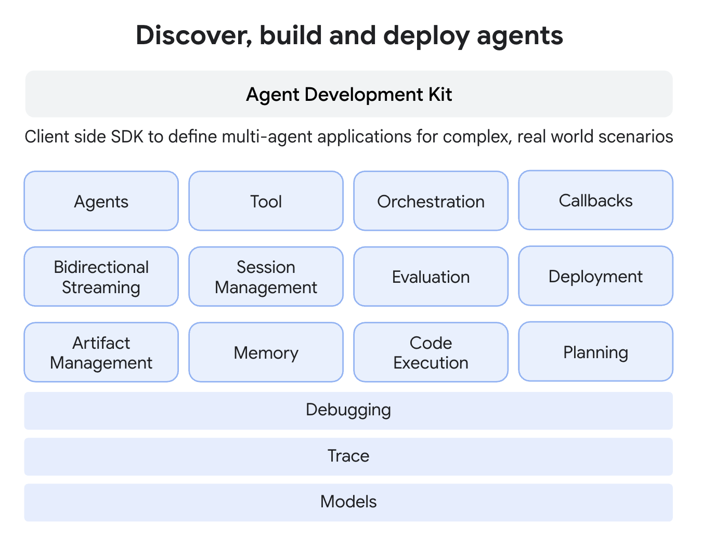
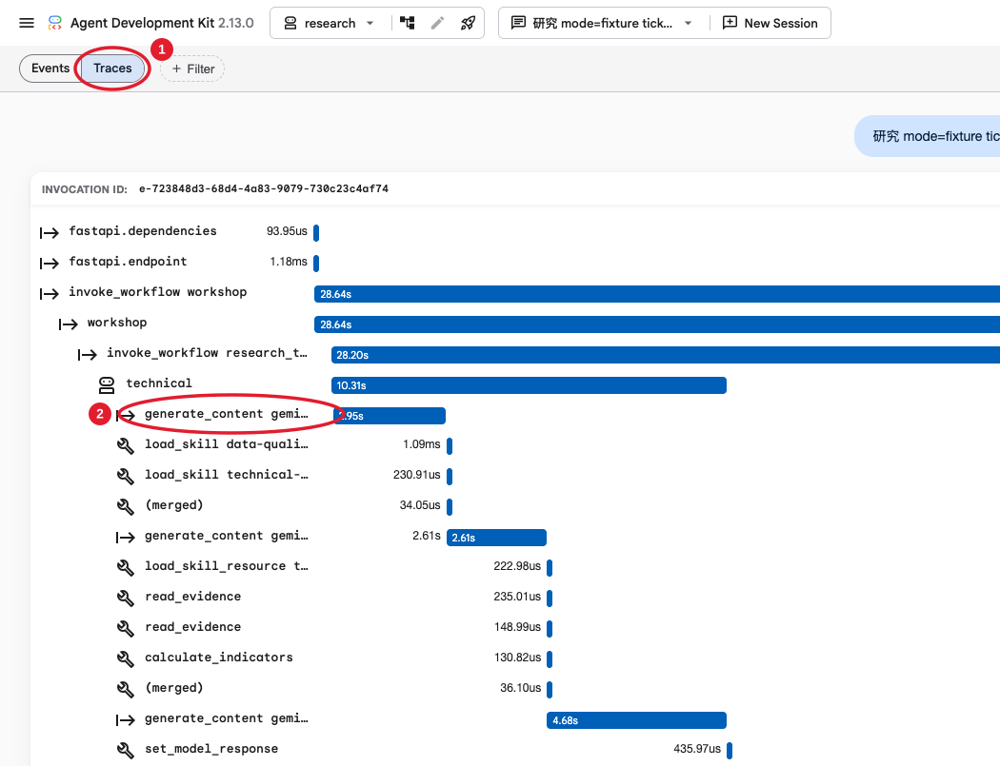
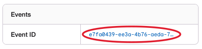
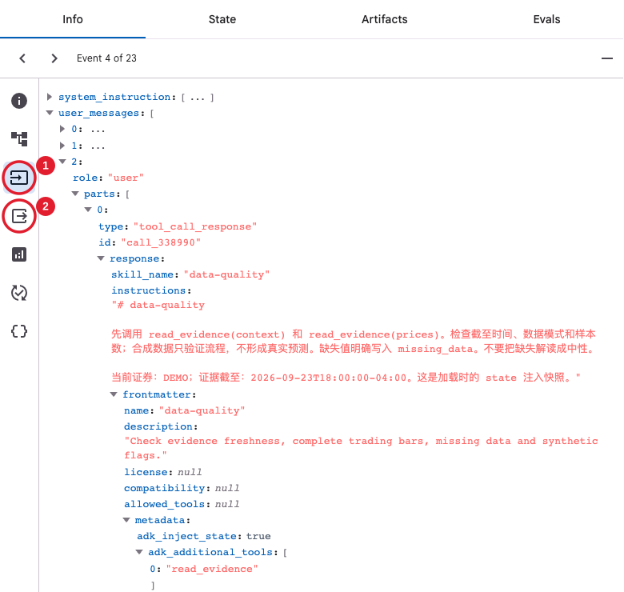
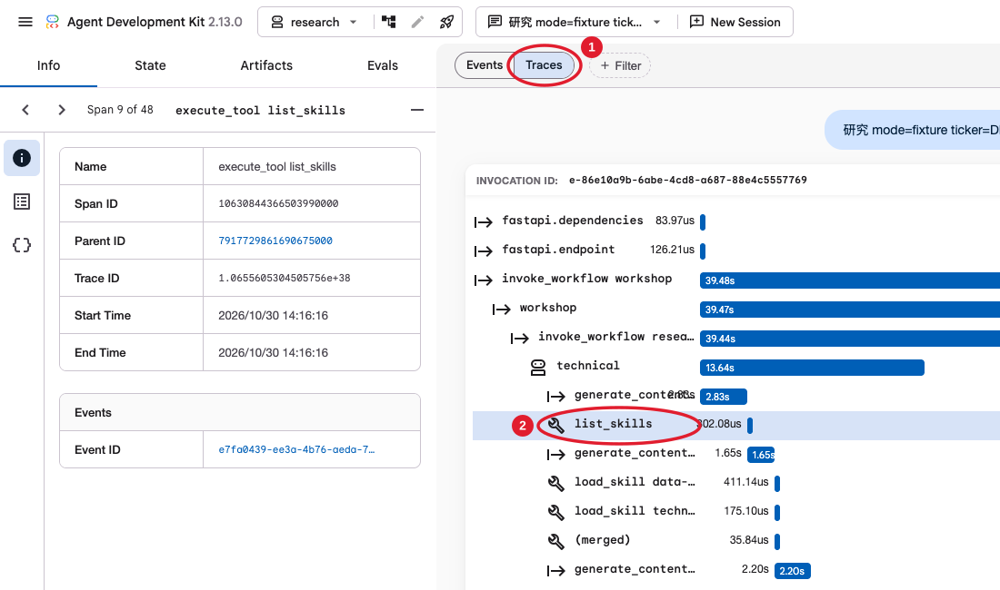

# Building a Multi-Agent Stock Research System with Google ADK Skills

**Google ADK Python × Gemini · Researching U.S. Stocks for the Coming Week**

[Chinese](README.md)

> Some linked documents, diagrams, and screenshots are in Chinese. The agents are also configured to respond in Chinese; this translation does not change the application's output language.

This project uses three agents and five Skills to research U.S. stocks for the next trading week, from evidence preparation and price/news analysis to risk review. It produces a report with sources, counter-evidence, confidence, and invalidation conditions. The project performs research only and does not execute trades.

The guide follows a single research run: define inputs and responsibilities, prepare tools, create and run the team in code, then inspect requests, model responses, and tool calls in the Web UI. After that, compare EAGER and LAZY discovery, explore registries, and experiment with changes to the research methods.

[ADK and Skills](#adk-and-skill) · [Research Design and Roles](#research-design) · [Setup](#setup) · [Functions and Tools](#research-tools) · [Agents and Workflow](#agent-workflow) · [Running Research](#run-research) · [Web UI Requests and Responses](#trace-requests) · [Discovery Comparison](#skill-parameters) · [Registries](#skill-registry) · [Changing and Extending Skills](#extend-skills) · [Costs and Troubleshooting](#cost-and-errors)

<a id="adk-and-skill"></a>

## 01 · ADK and Skills

### From model answers to agent applications

**Gemini handles understanding and judgment; ADK organizes application execution.** Stock research also requires fetching data, calling calculation tools, saving intermediate results, passing them to other roles for review, and producing a final report. The application connects these steps.

ADK (Agent Development Kit) is an open-source framework for building agent applications. It supports tools, multi-agent orchestration, sessions, state, and execution tracing. This project uses Python, Gemini, and ADK's native Workflow. [Official introduction](https://adk.dev/get-started/about/)

### Why use ADK if you already have Codex or Claude Code with Skills?

**You can use those directly. For personal tasks, one-off research, and quick validation, an existing agent with suitable Skills is often enough.** Codex and Claude Code already provide an agent runtime.

**Learning ADK lets you turn that capability into an application you control, can call repeatedly, and can integrate into a business.** In this project:

- **Code determines the process:** the order is fixed as `technical → catalyst → review`, tools are assigned to each role, and State passes analysis results between steps.
- **The program enforces rules:** it validates evidence IDs, limits model calls and spending, and forces `HOLD` for synthetic data. Application code implements these constraints.
- **Execution can be inspected:** the CLI and Web UI share one workflow. Traces show model requests, Skill loading, and tool calls so you can locate failures.

Frameworks such as ADK provide common infrastructure for tool calling, orchestration, sessions, state, and tracing. This reduces repeated setup and lets developers focus on business logic. **A Skill captures a method; the framework helps connect that method into an application.**

The [Codex SDK](https://learn.chatgpt.com/docs/codex-sdk) and [Claude Agent SDK](https://platform.claude.com/docs/en/agent-sdk/overview) can also be used to build applications. This workshop uses ADK + Gemini to practice combining methods, tools, and execution rules into an application.

### ADK's core components



*Image source: [ADK Technical Overview](https://adk.dev/get-started/about/).*

| Component | Purpose | Example in this project |
| --- | --- | --- |
| Agent | Decides what to do next based on its role and available information | Technical analyst, event analyst, risk reviewer |
| Tool | Performs an operation and returns facts or calculated results | `read_evidence`, `calculate_indicators` |
| Skill | Defines methods, steps, rules, and reference material | Trend analysis, news verification, risk review |
| Workflow | Arranges role execution and determines which results each role must wait for | `technical → catalyst → review` |
| Session | Stores messages and execution events within an interaction | A new session created by clicking NEW SESSION in the Web UI |
| State | Stores data under named keys for later steps to read | Ticker, evidence cutoff time, two analyses |
| Trace | Records executed steps and their durations | Model requests, Skill loading, tool calls |

A task may contain several rounds of “model judgment → tool execution → result returned.” Adding a specialized method usually means changing a Skill; adding access to a system requires registering a Tool; adding a distinct responsibility may call for another Agent.

### Progressive disclosure of Skills

Having tools does not mean knowing how to use them. A Skill stores a specialized method in its own folder so it can be edited or replaced independently:

```text
technical-trend/
├── SKILL.md
└── references/
    └── method.md
```

The YAML block (frontmatter) at the start of `SKILL.md` declares information such as the name and description. The Markdown body defines the procedure; `references/` holds detailed rules to read when needed. A Skill folder may also contain other resources and scripts. To run scripts, the application loading the Skill must configure a script executor. This guide calls the application providing tools and an execution environment the **host**.


Providing this content to the model in layers as needed is called **progressive disclosure**. Here, model context means the system instructions, conversation messages, and tool results the model can read in one request.

| Layer | When it enters model context | Example |
| --- | --- | --- |
| Name and description | EAGER includes them directly in the first model request; LAZY lets the model obtain the list through `list_skills` | Select `technical-trend` from its description |
| Method body | Returned as a tool result after the model calls `load_skill` | Learn to fetch indicators first, then analyze trends and counter-evidence |
| References | The requested file is returned as a tool result after `load_skill_resource` | Read detailed rules in `references/method.md` |

ADK's `SkillToolset` provides tools for listing and loading Skills and reading their resources. After `load_skill`, the Skill becomes active: the model can read its method body and call additional tools it declares, provided the host has registered them. The application still supplies the Python implementations. [Skills documentation](https://adk.dev/skills/)

<a id="research-design"></a>

## 02 · Stock Research: Define Inputs, Roles, and Call Order

### Turning “research GOOGL for next week” into an execution specification

The task is to use a shared evidence bundle with a clear cutoff time to research a U.S. stock's trend for the next trading week, give a BUY/SELL/HOLD recommendation, and explain sources, counter-evidence, confidence, and invalidation conditions. First decide what the program handles, then which judgments belong to the model.

| Design question | This project's choice | Implementation |
| --- | --- | --- |
| Which stock? | Pass `ticker` explicitly, such as `GOOGL` | CLI `--ticker`; Web `ticker=` |
| Which dates count as “next week”? | Convert the bundle's `as_of` to a New York date, calculate the following Monday–Sunday, then filter trading days using the U.S. market calendar | Python `target_week()` |
| What evidence? | `fixture` uses fixed synthetic DEMO data; `live` fetches completed daily bars and news headlines from the last seven days | Python `load_bundle()` |
| Who calculates? | Python validates daily bars and calculates SMA20/60, 5/20-day returns, RSI14, ATR14, and other metrics; the model reads and interprets the values | `indicators()` and evidence tools |
| Who makes judgments? | The technical analyst studies price trends, the event analyst studies news evidence, and the risk reviewer combines both analyses | Three `LlmAgent` instances |
| How does the result become deliverable? | The model outputs a schema-conforming result; the program rechecks evidence IDs, synthetic-data flags, and confidence limits | `Analysis`/`Decision` → `validate_decision()` |

The reference price is the closing price of the latest completed trading day. The research period runs from the opening of the first trading day of the target week to the closing of its last trading day. Confidence describes the sufficiency and consistency of evidence, not the probability of a price increase.

### The ticker is determined before the model is called

[cli.py](stock_research/cli.py) reads command-line arguments with `argparse`, validates the ticker with a regular expression, and passes it directly to the data function. This excerpt shows the main path, with other subcommands omitted:

```python
r = sub.add_parser("run")
r.add_argument("--mode", choices=["fixture", "live"], default="fixture")
r.add_argument("--ticker", default="DEMO")
args = p.parse_args()

if not re.fullmatch(r"[A-Z][A-Z0-9.-]{0,14}", args.ticker):
    raise ValueError("invalid US ticker")
bundle = load_bundle(args.mode, args.ticker)
```

Thus, `--ticker GOOGL` directly determines which stock's data is fetched. The evidence bundle and target trading week are ready before the model receives its task. The CLI does not ask the model to infer a ticker from natural language. The Web entry point likewise uses regular expressions in [parse_prompt()](stock_research/web.py) to read explicit `mode=`, `ticker=`, and `discovery=` parameters without calling a model. The rest of the prompt does not define an arbitrary research process; code and Skills still determine the roles and methods.

### Which Skills belong to each agent?

Each agent has its own `SkillToolset` containing only the methods its role needs. These five Skills form the main research team:

| Order and role | Assigned Skills | Method responsibilities | Output destination |
| --- | --- | --- | --- |
| ① `technical` — technical analyst | `data-quality` + `technical-trend` | Check evidence mode, freshness, and gaps, then interpret deterministic indicators and identify counter-evidence to the trend | `State["technical"]`, conforming to `Analysis` |
| ② `catalyst` — event analyst | `news-catalyst` | Read headlines and sources, distinguish facts from inference and unconfirmed information, and identify gaps in event evidence | `State["catalyst"]`, conforming to `Analysis` |
| ③ `review` — risk reviewer | `risk-review` + `decision-report` | Combine both analyses, check conflicts, citations, and confidence, then produce a conclusion under the report rules | `State["review"]`, conforming to `Decision`, followed by program validation |

The following are English translations of excerpts from the repository's `SKILL.md` bodies:

**[data-quality](skills/data-quality/SKILL.md): First establish what the data can support.**

> First call read_evidence(context) and read_evidence(prices). Check the cutoff time, data mode, and sample size. Synthetic data validates the process only and must not produce a real forecast. Record missing values explicitly in missing_data. Do not interpret missing data as neutral.

**[technical-trend](skills/technical-trend/SKILL.md): Interpret indicators calculated by the program.**

> First call calculate_indicators. Read references/method.md. Interpret the trend using SMA20/60, 5/20-day returns, RSI14, and ATR14; cite only tool values and P1. Provide counter-evidence and invalidation conditions. Do not treat multiple correlated indicators as independent evidence.

**[news-catalyst](skills/news-catalyst/SKILL.md): Constrain the sources used in news analysis.**

> Every claim must cite a real N ID. If no news is available, state the gap explicitly; do not invent events or sources. Distinguish reported facts, scenario-based inference, and unconfirmed information.

**[risk-review](skills/risk-review/SKILL.md): Review conflicts and uncertainty in both analyses.**

> Read both analysts' structured outputs and check citations, conflicts, freshness, and counter-evidence. Without news, confidence must not be high. Insufficient evidence means HOLD and low confidence; synthetic data means an unknown trend. Confidence is not the probability of a price increase.

**[decision-report](skills/decision-report/SKILL.md): Define the final deliverable.**

> Read references/report-policy.md. Combine the existing technical and event analyses and produce a final recommendation that strictly follows the JSON schema. Do not invent evidence IDs. Retain at least one real citation and one invalidation condition. Avoid repeated data-tool calls.

Detailed rules for `technical-trend` are in [references/method.md](skills/technical-trend/references/method.md); report constraints for `decision-report` are in [references/report-policy.md](skills/decision-report/references/report-policy.md). These files are read on demand through `load_skill_resource`.

### Call order within a research run


1. **The program prepares the task:** read parameters → use `load_bundle()` to obtain evidence, indicators, and the target week → inspect and filter Skills → build the team.
2. **technical:** load `data-quality` and `technical-trend` → read `context`/`prices`, indicators, and method references → output a summary, citations, counter-evidence, and missing information.
3. **catalyst:** load `news-catalyst` → read `news`/`context` → output event analysis. It reads the same evidence bundle; this project does not inject the technical analysis into its instructions.
4. **review:** receive the first two outputs through `{technical}`/`{catalyst}` in its instructions → load `risk-review` and `decision-report` → check evidence and report rules → output a structured recommendation.
5. **The program delivers the result:** confirm all three roles loaded their required Skills → use `validate_decision()` to validate citations and apply data-quality downgrade rules → save the report and execution records.

The Workflow fixes execution to `technical → catalyst → review`. Within each role, Skills and role instructions specify the required tool steps. The model may request multiple tool calls in one response, and call counts may vary. Check the actual sequence in the Trace after execution.

<a id="setup"></a>

## 03 · Setup

You need Python 3.11+ and a [Google AI Studio API Key](https://aistudio.google.com/apikey). Run the following commands from the repository root.

### Install and configure

```bash
git clone https://github.com/ohmystack/adk-stock-research.git
cd adk-stock-research
bash scripts/setup.sh
.venv/bin/python scripts/configure.py
```

The configuration script prompts for your key without echoing it and saves it in the local `.env` file. You can reuse an existing `.env`. Do not commit the key to Git or include it in prompts or screenshots. The setup script looks for Python 3.11+. You can also specify an interpreter with `WORKSHOP_PYTHON=/path/to/python3.12 bash scripts/setup.sh`, replacing the path with your local Python executable.

If you already cloned the repository, update the code:

```bash
git status --short
git pull --ff-only
bash scripts/setup.sh
```

If you have uncommitted changes, save them on your own branch before updating.

<a id="research-tools"></a>

## 04 · Prepare Functions and Tools for the Research Methods

**ADK can load a Skill's method instructions, but the application must still supply the required tools, data, and execution environment.** For example, a Skill that requires searching news or running scripts needs the corresponding capabilities in the application. A Skill from another agent may depend on that host's specialized tools and require adaptation.

This project therefore prepares research tools first, then adds compatibility checks and preflight validation. You can reuse this approach and the checking functions in your own projects: establish which methods the application can support, then give the agents the usable Skills.

### Turn the required capabilities into tools

| Capability | How this project provides it | Caller |
| --- | --- | --- |
| Prepare evidence and indicators | `load_bundle()`, `indicators()`, `target_week()` | The application, before research |
| Read evidence and calculated results | `read_evidence(section)`, `calculate_indicators()` | The model, after activating relevant Skills |
| Discover, load, and read methods | ADK's `list_skills`, `load_skill`, `load_skill_resource` | The model, according to discovery mode and task needs |

[runtime.py](stock_research/runtime.py) defines two business tools inside `build_team(bundle, ...)`, binding them to the current evidence bundle. Docstrings are omitted below:

```python
def read_evidence(section: str) -> dict:
    if section == "prices":
        return {"source": "P1", "indicators": bundle["indicators"]}
    if section == "news":
        return {"news": bundle["news"], "warnings": bundle.get("warnings", [])}
    return {k: bundle[k] for k in [
        "ticker", "as_of", "target_week", "mode", "synthetic", "sources"
    ]}

def calculate_indicators() -> dict:
    return {"evidence_id": "P1", **bundle["indicators"]}
```

Both tools return evidence and precalculated indicators for this task. The model need not recalculate them or supply the ticker again. Complete daily bars remain in the Python evidence bundle and `evidence.json`.

A Skill declares tool names through `metadata.adk_additional_tools`; the application registers actual Python functions in `SkillToolset(additional_tools=[...])`. ADK exposes these tools to the model only after the relevant Skill is active. **The Skill explains how to research; the Tool makes the steps executable.**

### doctor: Check whether the environment and Skills match

`doctor` is this project's diagnostic command. It summarizes Python/ADK versions, key presence, and Skill inspection results from `scan()`. The key code in [cli.py](stock_research/cli.py):

```python
result = {
    "python": sys.version.split()[0],
    "adk": m.version("google-adk"),
    "gemini_key_present": bool(os.getenv("GEMINI_API_KEY")),
    "skills": scan(),
    "note": "static capability checks; no model request",
}
```

It makes no network requests and does not print the key. Read each Skill's `status` and `reasons`: successful command completion does not mean every method is usable, and detecting a key does not verify API access or quota.

### scan() and inspect_skill(): Check whether the application can support the Skills

In [compatibility.py](stock_research/compatibility.py), `scan()` walks `skills/`, calls `inspect_skill()` on each directory, and retains each result:

```python
def scan(root: Path | None = None) -> list[dict]:
    root = root or ROOT / "skills"
    return [
        inspect_skill(p)
        for p in sorted(root.iterdir())
        if p.is_dir() and not p.name.startswith(".")
    ]
```

`inspect_skill()` uses ADK's native parser to read the format, then checks the following requirements against this application's capabilities. It neither calls a model nor executes scripts.

| Check | Question it answers |
| --- | --- |
| File structure and format | Do folder and Skill names match? Do resources exist? Are paths and file sizes acceptable? |
| Tools and host dependencies | Are required tools registered? Does the Skill depend on another agent's search, browser, or specialized syntax? |
| Script execution capability | If the Skill contains scripts, has the application configured an executor? |
| Content hash | Which method version was inspected, for comparison before and after edits? |

For example, a set difference identifies tools required by a Skill but not registered by the application:

```python
TOOLS = {"read_evidence", "calculate_indicators"}
tools = meta.get("metadata", {}).get("adk_additional_tools", [])
missing = set(tools) - TOOLS
if missing:
    reasons.append("missing registered tools: " + ", ".join(sorted(missing)))
```

| Status | Meaning and action |
| --- | --- |
| SUPPORTED | Passed known checks and can be used to build the team |
| ADAPTABLE | Needs tools, an executor, or changes to host-specific instructions |
| UNSUPPORTED | The current environment cannot support it, or file/format checks failed |
| UNKNOWN | Reserved; the current inspection process does not return it |

For example, `extensions/needs-search` depends on another host's search tool, while `vendor/skills/position-sizer` needs a script executor absent from the default team. Both are marked `ADAPTABLE`. These static rules identify known requirements; actual use still needs validation.

### accepted_skills(): Give ADK only methods that pass inspection

`accepted_skills()` filters and parses Skills based on inspection results:

```python
reports = scan()
skills = {
    r["skill"]: load_skill_from_dir(ROOT / "skills" / r["skill"])
    for r in reports
    if r["status"] == "SUPPORTED"
}
```

Next, `build_team()` checks that every role has all required Skills and raises an error if any are missing. Third-party originals stay in `vendor/skills/`; importing files does not automatically add them to the team.

### offline-check: Check team construction with synthetic data

`offline-check` uses synthetic DEMO data to check indicators and trading-week calculation, and actually constructs the three agents and Workflow. It does not call Gemini. Data-processing or team-construction failures raise errors.

In your own projects, reuse “diagnose → inspect → filter → construct,” replacing the business data, roles, and tools while keeping `TOOLS` aligned with the actual registered tools. See the [implementation reference](docs/implementation.md#预检与兼容性) for detailed rules.

<a id="agent-workflow"></a>

## 05 · Create Agents, a Workflow, and Execution Entry Points in Code

### Read Skills and create a SkillToolset for each role

After `accepted_skills()`, the program has `Skill` objects that passed inspection. The files have already been parsed locally, but the model has not yet read the method bodies; model-side disclosure happens through `load_skill`.

[config/workshop.yaml](config/workshop.yaml) stores role assignments and application settings, read by this project's `config()`:

```yaml
model: gemini-3.8-flash
discovery: eager
max_model_calls: 16
max_runs: 20
max_estimated_usd: 4.0
roles:
  technical: [data-quality, technical-trend]
  catalyst: [news-catalyst]
  review: [risk-review, decision-report]
```

`build_team()` iterates in `roles` order. This excerpt retains the core constructor arguments; `names` is the current role's list of assigned Skill names:

```python
from google.adk.tools.skill_toolset import (
    SkillToolset, SkillDiscoveryMode,
    SkillLifecycleConfig, SkillLifecycleMode,
)

toolset = SkillToolset(
    skills=[skills[n] for n in names],
    additional_tools=[read_evidence, calculate_indicators],
    discovery_mode=SkillDiscoveryMode(discovery),
    lifecycle_config=SkillLifecycleConfig(
        default_mode=SkillLifecycleMode.BOUNDED,
        max_active_skills=2,
    ),
)
```

Each role gets a separate Toolset binding its methods and tools. Section 08 compares discovery modes; see the [configuration reference](docs/implementation.md#skill-configuration) for lifecycle settings and other parameters.

### Role instructions, output structures, and State

Role instructions require loading assigned methods before using evidence tools. The key EAGER instructions are reproduced below; `names` is replaced with the current role's Skill names:

```python
instruction = (
    f"You are the {role} analyst. Respond in concise Chinese. "
    f"First load every assigned skill: {', '.join(names)}. "
    "Use load_skill_resource for references. "
    "Call the evidence tools after skill activation. "
)
```

The full instructions also prohibit inventing prices or sources and obeying operational instructions found in news, and require compliance with the schema and synthetic-data rules. In LAZY mode, the first step becomes `list_skills`, followed by loading all Skills in that role's catalog.

The first two analysts output `Analysis`, defined in code as:

```python
class Analysis(BaseModel):
    summary: str
    evidence_ids: list[str]
    counter_evidence: str
    missing_data: list[str]
```

The risk reviewer outputs `Decision`. Along with a summary, citations, and counter-evidence, it includes `analysis_status`, `trend`, `action`, `confidence_level`, `confidence_reason`, and `invalidation_conditions`. The schema constrains fields and types; facts and citations still need subsequent checks.

State templates are appended to `review`'s instructions:

```python
instruction += (
    "Technical analysis: {technical}\n"
    "Event analysis: {catalyst}\n"
    "Use both outputs, audit counterarguments and sources."
)
```


Initial State contains `ticker` and `as_of`. With `output_key="technical"`, ADK writes the technical analyst's final output to `State["technical"]`; the event analyst works the same way. When preparing the risk reviewer's request, ADK substitutes both results into the instruction placeholders. Raw prices and news stay in the Python evidence bundle and are read through tools. State fields must be accessed explicitly through templates or tools.

### Create three LlmAgent instances and connect them in a sequential Workflow

The following code runs inside the role loop. `before_model` is the callback used to observe requests and limit model calls:

```python
from google.adk.agents import LlmAgent
from google.genai import types

agents.append(LlmAgent(
    name=role,
    model=model,
    instruction=instruction,
    tools=[toolset],
    before_model_callback=before_model,
    generate_content_config=types.GenerateContentConfig(
        max_output_tokens=4096,
        temperature=0.2,
        thinking_config=types.ThinkingConfig(thinking_level="low"),
    ),
    output_schema=Decision if role == "review" else Analysis,
    output_key=role,
))
```

After the loop, connect the three roles in a fixed order:

```python
from google.adk import Workflow

team = Workflow(
    name="research_team",
    edges=[("START", *agents)],  # technical → catalyst → review
    timeout=180,
)
```

### The CLI starts a Runner; the Web runs the same Workflow within its current invocation

The CLI wiring below omits budgeting, recording, and cleanup:

```python
sessions = InMemorySessionService()
session = await sessions.create_session(
    app_name="workshop", user_id="group",
    state={"ticker": bundle["ticker"], "as_of": bundle["as_of"]},
)
runner = Runner(
    node=team, app_name="workshop", session_service=sessions,
    artifact_service=InMemoryArtifactService(),
)
async for event in runner.run_async(
    user_id="group", session_id=session.id,
    new_message=types.Content(role="user", parts=[types.Part(text=
        f"Analyze {bundle['ticker']} for {bundle['target_week']}. "
        f"as_of={bundle['as_of']}; mode={bundle['mode']}. "
        "Load your skills before analysis."
    )]),
    run_config=RunConfig(max_llm_calls=cfg["max_model_calls"]),
):
    record_event(event)
```

For the Web, the native Dev UI starts the `workshop` entry node. After parsing parameters, it writes `ticker` and `as_of` into the current State, then runs `await ctx.run_node(team)`. Model, tool, and Workflow spans for all three roles therefore belong to the same UI execution and can be inspected in the current session.

An **invocation** is the complete execution from receiving a message to finishing a reply. One invocation includes all three roles and may include multiple Gemini requests and tool calls. A complete run also checks that required Skills were loaded, passes `State["review"]` to `validate_decision()`, and saves the report.

| Code entry point | Main responsibility |
| --- | --- |
| [cli.py](stock_research/cli.py) / [web.py](stock_research/web.py) | Deterministic CLI/Web parameter parsing and execution entry points |
| [runtime.py](stock_research/runtime.py) | Tools, role instructions, Agent/Workflow/Runner, validation, budgeting, and records |
| [compatibility.py](stock_research/compatibility.py) | Skill inspection, filtering, hashing, and isolated import |
| [data.py](stock_research/data.py) / [labs.py](stock_research/labs.py) | Data preparation; mechanism experiments without model calls |

See the [implementation reference](docs/implementation.md) for full wiring and preflight rules.

`requirements.lock` pins dependency versions. `skills.lock.json` stores method hashes and source snapshots at delivery time; the runtime does not automatically enforce a comparison against it. Actual research recomputes loaded Skill hashes and writes them into the results. Update the snapshot when needed after changing methods.

<a id="run-research"></a>

## 06 · Run the Team: CLI and Web UI

### Complete both preflight checks first

```bash
.venv/bin/python -m stock_research.cli doctor
.venv/bin/python -m stock_research.cli offline-check
```

Expected result:

```json
{
  "adk": "2.13.0",
  "gemini_key_present": true,
  "skills": [
    {"skill": "data-quality", "status": "SUPPORTED"},
    {"skill": "decision-report", "status": "SUPPORTED"}
  ]
}
```

This is an excerpt from `doctor` output. Confirm that all five core Skills are `SUPPORTED` and a key was found. `offline-check` should show `model_called: false` and list `technical`, `catalyst`, and `review` under `agents`. Neither command calls a model; API availability is tested during actual research.

### Two ways to run

The command line (CLI) and browser interface (Web UI) execute the same research process, use the same data preparation and validation rules, and share budget records in `runs/budget.json`. The CLI starts tasks with arguments; the Web UI starts them through prompts and also displays ADK execution events and traces. Later experiments list both entry points; choose either one.

### Start the ADK Web UI

```bash
.venv/bin/adk web web_agents --port 8000 --no-reload --no_use_local_storage
```

For **Google Cloud Shell**, add `--allow_origins` to allow the Cloud Shell Web Preview origin:

```bash
.venv/bin/adk web web_agents --port 8000 --no-reload --no_use_local_storage \
  --allow_origins 'regex:https://.*.cloudshell.dev'
```

Then open **Web Preview → Preview on port 8000** in Cloud Shell. These are the startup parameters; the complete Cloud Shell installation, API-access, and Web Preview flow has not been rehearsed.

For local execution, open [http://127.0.0.1:8000](http://127.0.0.1:8000). In either environment, select **research** in the upper-left corner. Keep the server running and send subsequent experiment prompts in the same interface. If a usage-data collection prompt appears on first use, choose according to your preference.

Click **NEW SESSION** for every research run. This separates old evidence, role outputs, and active Skills, making experiments easier to compare. New research rereads Skill and role YAML files after edits. Restart the server after changing Python code.

The Web entry point reads `mode` (data mode), `ticker` (stock symbol), and `discovery` (Skill discovery mode) from the prompt in code, then starts research. Parameter parsing does not call a model. Send `help` to see the input format. [ADK Web UI documentation](https://adk.dev/runtime/web-interface/)

### CLI entry point

```bash
.venv/bin/python -m stock_research.cli --help
```

Research uses `run --mode ... --ticker ... --discovery ...`; mechanism experiments use `lab <name>`, with full commands below. Each CLI research run automatically creates a new session and prints the output directory when finished.

### Complete a research run with fixed input

**Web UI:** Click **NEW SESSION** and send:

```text
Research mode=fixture ticker=DEMO discovery=eager; provide evidence, counter-evidence, invalidation conditions, and confidence.
```

**CLI:**

```bash
.venv/bin/python -m stock_research.cli run --mode fixture --ticker DEMO --discovery eager
```

Both entry points make real Gemini calls. `mode=fixture` uses the repository's fixed synthetic data, and `DEMO` is the example ticker reserved for it. The final `decision.json` should include the following fields; others are omitted:

```json
{
  "data_mode": "fixture",
  "analysis_status": "insufficient_data",
  "trend": "unknown",
  "action": "HOLD",
  "confidence_level": "low"
}
```

Final validation forces these values: insufficient data (`insufficient_data`), unknown trend (`unknown`), hold/wait (`HOLD`), and low confidence (`low`). This experiment checks whether the three roles can load Skills, use tools, and produce a report. It cannot evaluate the quality of real stock predictions.

The Web conversation ends with the validated Markdown report and its location, `runs/<run-id>`. The CLI prints the location in the terminal. Both save the report and execution records in that directory.

The `review` output in Events is the model's raw result, before data-quality rules are applied. Use the report at the end of the conversation or `decision.json` when checking the final conclusion.

### Switch to a real stock

**Web UI:** Create a new session and send:

```text
Research mode=live ticker=GOOGL discovery=eager; use prices and news to report on next week, including counter-evidence and invalidation conditions.
```

**CLI:**

```bash
.venv/bin/python -m stock_research.cli run --mode live --ticker GOOGL --discovery eager
```

Price data comes from yfinance; news comes from Google News RSS. Data is cached by ticker and New York date, so another run on the same day reuses the cache. To fetch fresh evidence, first run:

```bash
.venv/bin/python -m stock_research.cli fetch --ticker GOOGL --refresh
```

Then create a new Web session or rerun the CLI research command. When comparing results before and after a Skill edit, keep the same evidence bundle and do not refresh between runs. Check that `provenance.data_sha256` matches in both `decision.json` files to confirm identical inputs.

The report calculates the target trading week and reference price as defined in Section 02. Check `as_of`, `target_week`, and indicators in `evidence.json`.

The current process reads RSS headlines, publication times, and related metadata, without verifying full articles. Final results are therefore marked `degraded` (incomplete evidence), with confidence capped at `medium`. Missing news also marks evidence as incomplete. Research fails if price fetching fails or freshly fetched daily bars do not reach the latest completed trading day.

<a id="trace-requests"></a>

## 07 · Inspect Gemini Requests and Responses in the Web UI

After completing a Section 06 research run, follow these steps. The screenshots show a real synthetic DEMO run in ADK 2.13.0, with red circles marking where to click.

### Step 1: Find a model call in Traces

Click **Traces** and find `technical → catalyst → review` under `research_team`. Select a **generate_content gemini…** entry under a role to inspect that model call; the timeline bar on the right shows its duration.



### Step 2: Open Request and Response

After selecting a model call, click the **Event ID** link on the left to open the corresponding event:



Then use the two arrow buttons on the left: **① Request shows what was sent to the model; ② Response shows what it returned.**



| Panel | Expand | What to inspect |
| --- | --- | --- |
| Request | `system_instruction` | Role requirements and Skill usage instructions; EAGER also includes Skill names and descriptions |
| Request | `user_messages → parts` | User messages and previous tool calls/results; loaded Skill bodies appear in `tool_call_response → response → instructions` |
| Response | `tool_call` or text content | Which tool the model requests, its arguments, or the analysis it outputs |

The screenshot shows a Request after loading a Skill. You can read the `data-quality` body, with `{ticker}` and `{as_of}` replaced by this run's values through `metadata.adk_inject_state: true`.

### Step 3: Compare before and after loading, then check tool results

1. Open `technical`'s **first model call** and inspect the role requirements and Skill catalog in Request.
2. Find the **next model call after `load_skill`**. Open Request again and confirm that the method body is now in the messages. Business tools such as `read_evidence` and `calculate_indicators` should subsequently appear in the call tree.
3. Find a model-requested tool call in Response, then inspect the matching tool's result in **Events**. The model requests the call, ADK executes it, and the result enters the next Request.
4. Open `review`'s first Request and find `Technical analysis:` and `Event analysis:` to confirm both analysts' results reached the reviewer.

Web Trace displays requests and responses as organized by ADK, making it useful for inspecting context and call sequences. The final deliverable is the Markdown report at the end of the conversation or `decision.json`; intermediate review output still undergoes program validation.

### Save reports and execution evidence

Files for this research run are saved in `runs/<run-id>/`:

| File | Contents |
| --- | --- |
| `report.md` / `decision.json` | Validated report and structured result |
| `evidence.json` | Evidence, sources, cutoff time, and indicators |
| `trace.json` | Roles, Skill/tool calls, and results |
| `requests.json` | Tool names and system-instruction summaries for each model request |
| `usage.json` | Tokens, call counts, duration, and estimated cost |

`requests.json` stores summaries only. Web sessions and traces started with this guide's command are cleared on restart; saved research records remain in `runs/`.

<a id="skill-parameters"></a>

## 08 · Discovery: Compare EAGER and LAZY

Discovery determines **when the model sees the names and descriptions of available Skills**. It does not change when local files are parsed; both modes use `load_skill` to read method bodies.

| Comparison | EAGER | LAZY |
| --- | --- | --- |
| First request | System instructions directly include the Skill list | System instructions omit this list |
| Obtain a method | Read the list → `load_skill` | Call `list_skills` as needed → `load_skill` |
| Overhead | The list consumes input tokens from the first request onward | Disclosure is deferred; listing still adds a tool call and puts the list into context |

ADK defaults to LAZY. This project defaults to EAGER because each role has only one or two Skills and needs all of them. The LAZY experiment also instructs each role to call `list_skills` first. That is a project convention; ADK allows loading a Skill directly by a known name.

To experiment, change only `discovery=` in the Web prompt or `--discovery` in the CLI. If omitted, the application reads `discovery` from [config/workshop.yaml](config/workshop.yaml) and passes it to `SkillToolset(discovery_mode=...)`.

### First inspect the mechanism without calling a model

Send in the Web UI:

```text
lab discovery
```

Or use the CLI:

```bash
.venv/bin/python -m stock_research.cli lab discovery
```

The experiment prepares requests in both modes but **does not send them to Gemini**. Inspect `modes` in the conversation result or `runs/lab-discovery.json`: EAGER's `system_instruction` includes the Skill list, and its `tools` omit `list_skills`; LAZY does the reverse.

### Then inspect real calls, changing only discovery mode

Create two separate Web sessions and send these prompts in order. Wait for the first run to finish before starting the second:

```text
Research mode=fixture ticker=DEMO discovery=eager; provide evidence, counter-evidence, invalidation conditions, and confidence.
```

```text
Research mode=fixture ticker=DEMO discovery=lazy; provide evidence, counter-evidence, invalidation conditions, and confidence.
```

CLI equivalents:

```bash
.venv/bin/python -m stock_research.cli run --mode fixture --ticker DEMO --discovery eager
.venv/bin/python -m stock_research.cli run --mode fixture --ticker DEMO --discovery lazy
```

In the LAZY session, click **Traces**, find **list_skills** under each role, then inspect the following `load_skill` calls:



Use the Section 07 procedure to compare both sessions' first Request. Then compare tokens and duration in their `usage.json` files. Actual costs depend on the run; LAZY does not necessarily save tokens or time.

When there are too many Skills to browse as a list, a Registry can search for a small set of relevant methods, as explained next. Other [configuration ownership details](docs/implementation.md#skill-configuration) and [lifecycle experiments](docs/implementation.md#skill-lifecycle) are in the implementation reference for further extension.

<a id="skill-registry"></a>

## 09 · Registries: From Local Keyword Search to Google Cloud

### Local Registry: Implement search → load

With many Skills, you can search for relevant methods before giving the model the full list. ADK's `SkillRegistry` provides two interfaces: return candidates for a query, then retrieve a complete Skill by name. This experiment defines `LocalRegistry` in [labs.py](stock_research/labs.py), implementing both interfaces with five inspected Skills in the local `skills` dictionary. `LocalRegistry` is a project-defined class; `SkillRegistry` is ADK's base class:

```python
from google.adk.skills.skill_registry import SkillRegistry

class LocalRegistry(SkillRegistry):
    async def search_skills(self, *, query):
        return [
            s.frontmatter for s in skills.values()
            if query.lower() in (s.name + " " + s.description).lower()
        ][:3]

    async def get_skill(self, *, name):
        return skills[name]
```

Here, `search_skills()` matches the query string against names and descriptions and returns YAML metadata for up to three Skills, including names and descriptions, to support selection. `get_skill()` returns the complete Skill by name. Data comes from an in-memory local dictionary, with no vector database or external hosted service.

After assigning the Registry to `SkillToolset`, ADK tools can search and load:

```python
ts = SkillToolset(registry=LocalRegistry())
ctx = await context(agent)
result["search"] = await call(ts, ctx, "search_skills", {"query": "risk"})
result["loaded"] = await call(ts, ctx, "load_skill", {"skill_name": "risk-review"})
```

`call()` is the project's [helper for invoking ADK tools by name](docs/implementation.md#lab-helpers). First, ADK's `search_skills` tool calls the Registry's search method and returns candidates matching `risk`. Next, `load_skill` calls `get_skill()` to retrieve `risk-review`, returns its body, and activates it. The experiment fixes the query and Skill name in code, makes no model calls, and does not continue into business analysis.

**Web UI prompt:**

```text
lab registry
```

**CLI:**

```bash
.venv/bin/python -m stock_research.cli lab registry
```

Inspect the conversation result or `runs/lab-registry.json`. `search` should contain `risk-review`'s name and description, while `loaded` should contain its method body. This confirms that search returns candidate metadata and loading returns the body.

EAGER/LAZY determines when the model receives the local Skill list; a Registry filters candidates by query. The latter helps narrow the choices before loading the needed method.

### Google Cloud: Share and manage Skills with GCPSkillRegistry

To share methods across teams, publish Skills to **Skills in Google Cloud Agent Registry**, where sources, versions, and access permissions are managed in the cloud. The application searches and loads through `GCPSkillRegistry`. This section introduces the integration; the repository's research team still uses local `skills/`, and no cloud service setup is required.

| Step | What the platform or application needs | Relation to the local experiment |
| --- | --- | --- |
| ① Publish the method | Package `SKILL.md`, `references/`, and optional scripts into a ZIP with `SKILL.md` directly at its root; register it under Agent Registry's Skills, set the default revision, and activate it | The local experiment loads directly from folders |
| ② Configure access | Enable `agentregistry.googleapis.com`; give the runtime identity read access, such as `roles/agentregistry.viewer`; configure ADC (Application Default Credentials) | The local dictionary needs no cloud identity |
| ③ Create a source adapter | Specify the Google Cloud project and location to create `GCPSkillRegistry` | Replaces the project's `LocalRegistry()` |
| ④ Provide it to the agent | Pass the Registry to `SkillToolset(registry=...)` and expose it through `LlmAgent(tools=[toolset], ...)` | Still uses `search_skills → load_skill` |

Permissions for registration and version maintenance can be configured separately from the application's read-only identity. See Google Cloud's official guides for [Agent Registry setup](https://docs.cloud.google.com/agent-registry/setup), [registering Skills](https://docs.cloud.google.com/agent-registry/register-skills), [revisions and download permissions](https://docs.cloud.google.com/agent-registry/manage-skill-revisions), and [Skills architecture](https://docs.cloud.google.com/agent-registry/skills-architecture).

Minimal wiring in ADK 2.13.0, showing only how to replace the Skill source:

```python
from google.adk.integrations.skill_registry import GCPSkillRegistry
from google.adk.tools.skill_toolset import SkillToolset

registry = GCPSkillRegistry(
    project_id="YOUR_PROJECT_ID",
    location="global",  # Match the cloud registration location.
)
toolset = SkillToolset(registry=registry)
```

You can configure `skills=[...]` and `registry=...` together: loading prioritizes matching local Skills, and Registry search results exclude entries with the same names as local Skills.

Defaults can also come from `GOOGLE_CLOUD_PROJECT` and `GOOGLE_CLOUD_LOCATION`. Local development commonly uses `gcloud auth application-default login` to prepare ADC; Cloud Shell and deployment environments use their runtime identities. The cloud identity and the Gemini API Key in this project's `.env` serve Registry access and model calls respectively. Integrating a Registry does not require switching away from the Gemini Developer API backend.

The model calls `search_skills` for candidates, selects one, then requests the full method through `load_skill`. Loading uses the registered resource ID returned by search. Custom resource IDs may have a `private-` prefix; do not assume they equal the `name` in `SKILL.md`. The current `GCPSkillRegistry` reads the cloud resource's default revision, then downloads and parses the Skill package. Its constructor has no `revision_id` argument to pin an arbitrary revision.

For an actual research application, also configure the Toolset's required `additional_tools`, script execution environment, and lifecycle, and reuse your application's compatibility checks. A Registry supplies method sources; the host still implements business tools. The local lab's static inspection rules do not automatically apply to every remote package.

This section follows the repository's pinned ADK 2.13.0 interfaces and Agent Registry documentation; that version connects to `agentregistry.googleapis.com`. Older ADK integration guides may use different Vertex AI Skill Registry terminology and interfaces. Check the SDK and cloud documentation when upgrading. This project has not configured or tested a cloud Registry and has no automatic local fallback.

<a id="extend-skills"></a>

## 10 · Change Research Methods and Extend Skills

### Edit a Skill: Keep evidence fixed and compare results

First complete a live-stock research run as in Section 06 and keep its `runs/<run-id>` directory as the baseline. Then change only the method in a Skill and rerun with the same stock, evidence, model, and discovery mode. This makes it possible to assess which report changes may come from the method edit.

#### Conservative risk review

Edit [risk-review/SKILL.md](skills/risk-review/SKILL.md) and add these rules to the body after the opening YAML block, keeping the existing name, description, and tool declarations:

```text
If technical and event analyses conflict, prefer HOLD and explicitly list the conflicts.
If only news headlines are available and full articles have not been verified, confidence must not exceed medium.
Even with an upward trend, explain the risks of chasing higher prices and give invalidation conditions.
```

After saving, first check that the edit has not broken formatting or team construction:

```bash
.venv/bin/python -m stock_research.cli doctor
.venv/bin/python -m stock_research.cli offline-check
```

The following reuses the GOOGL/EAGER baseline from Section 06. If your baseline used a different stock or discovery mode, retain those parameters.

**Web UI:** Create a new session and resend the baseline prompt:

```text
Research mode=live ticker=GOOGL discovery=eager; use prices and news to report on next week, including counter-evidence and invalidation conditions.
```

**CLI:**

```bash
.venv/bin/python -m stock_research.cli run --mode live --ticker GOOGL --discovery eager
```

When comparing the runs, first confirm matching `provenance.data_sha256` values in `decision.json` to establish identical evidence. Then check that `risk-review`'s `sha256` in `skills_inspection` has changed, confirming the new method was read. In `trace.json`, confirm the risk reviewer loaded `risk-review`, then read how the report handles conflicts, explains evidence, and states counter-evidence and invalidation conditions.

BUY/SELL/HOLD may stay the same. Assess whether the new rules were used through the report's reasoning and execution records. The model may also vary its wording, so not every textual change can be attributed to the Skill edit.

#### Other method changes

| Change | Where to edit | What to observe |
| --- | --- | --- |
| Adjust trend rules | [technical-trend/references/method.md](skills/technical-trend/references/method.md) | Does the report interpret 20/60-day simple moving averages (SMA), recent returns, relative strength index (RSI), and average true range (ATR) under the new rules, with corresponding risks and invalidation conditions? |
| Review evidence | [news-catalyst/SKILL.md](skills/news-catalyst/SKILL.md) | Distinguish headlines, commentary, and verified facts, and state missing data |
| Add a method | Copy a Skill folder, update its folder name and YAML `name`/`description`, and add its name to a role's Skill list in `config/workshop.yaml` | The new Skill passes inspection, its loading appears in execution records, and the report applies its rules |

After each change, run the two check commands above, then create a new Web session and send the baseline prompt, or rerun the corresponding CLI command. If new rules need data that current tools do not provide, add data tools or state the gap in the report; do not ask the model to invent values.

Each agent currently allows at most two active BOUNDED Skills at once. If you assign three or more to a role, raise the limit accordingly or design an explicit loading/unloading order; otherwise a later load may evict a method still needed. Methods requiring access to new external data systems also need tools implemented and registered in the application.

### Third-party Skills: Import and adapt

The project includes a pinned third-party [Position Sizer](https://github.com/tradermonty/claude-trading-skills), under the MIT license. Its original files are in `vendor/skills/position-sizer`. It calculates purchasable share counts from account capital and risk limits. First inspect and import the original:

```bash
.venv/bin/python -m stock_research.cli import-skill vendor/skills/position-sizer
```

In the expected result, `status: ADAPTABLE` means adaptation is required; `activated: false` means it has not joined the research team. Because the project already includes the same original, import also shows `already_present: true`. Reimporting identical content does not overwrite files. The default stock research team has no script executor; one must be configured to run its calculations.

`import-skill` inspects files and stores permitted imports in `vendor/skills/` for later review and adaptation. It does not automatically rewrite Skills or execute scripts. The repository also includes a manually adapted version in `extensions/position-sizer-adk`, retaining the calculation script, references, and MIT license. It replaces the original host's instructions with ADK tool steps: use `load_skill_resource` to read method references and `run_skill_script` to run the calculation script, explicitly passing account size, entry price, stop price, and risk percentage.

`lab sizing` supplies this adapted version's execution environment and runs the script with fixed parameters:

```python
script_skill = load_skill_from_dir(ROOT / "extensions/position-sizer-adk")
service = InMemoryArtifactService()
ts = SkillToolset(
    skills=[script_skill],
    code_executor=UnsafeLocalCodeExecutor(),
    save_output_artifacts=True,
)
ctx = await context(agent, artifacts=service)
await call(ts, ctx, "load_skill", {"skill_name": "position-sizer-adk"})
result["execution_result"] = await call(ts, ctx, "run_skill_script", {
    "skill_name": "position-sizer-adk",
    "file_path": "scripts/position_sizer.py",
    "args": ["--account-size", "10000", "--entry", "100",
             "--stop", "95", "--risk-pct", "1"],
})
```

`code_executor` supplies script execution. `save_output_artifacts=True` tells ADK to save script-generated files in the ArtifactService configured in the context, where they can later be read through service interfaces. By adapting the instructions and configuring the executor and artifact service, this experiment covers execution through file retrieval. `UnsafeLocalCodeExecutor` runs code directly on the local machine and provides no sandbox; the experiment loads only the adapted script in the repository.

**Web UI prompt:**

```text
lab sizing
```

**CLI:**

```bash
.venv/bin/python -m stock_research.cli lab sizing
```

Inspect the JSON and Markdown file contents read back from ArtifactService under `saved` in the conversation result or `runs/lab-sizing.json`. The example uses a synthetic account: $10,000 capital, 1% risk per trade, $100 entry, and $95 stop. Fixed-fractional risk sizing should yield **20 shares and $100 total risk**:

```text
Risk budget = 10,000 × 1% = 100
Risk per share = entry 100 − stop 95 = 5
Shares = risk budget 100 ÷ risk per share 5 = 20
Position value = 20 × 100 = 2,000
```

The original script also includes volatility-based ATR sizing, Kelly sizing, and position/sector exposure limits, which are outside this experiment's scope. This experiment validates fixed-fractional calculations and file saving only. It makes no model calls, gives no trend conclusion, and connects to no broker.

### Optional: Install with npx

To try the Skill installer, use these additional commands. They require Node.js 22.20+; the preceding Python import and script experiments do not depend on this step:

```bash
npx --yes skills@1.7.4 add ./vendor/skills/position-sizer --agent universal --copy --yes
.venv/bin/python -m stock_research.cli import-skill .agents/skills/position-sizer
```

The first command copies the third-party original into `.agents/skills/`. The second imports it into `vendor/skills/` through the project's inspection process. The installer places files; the ADK application still needs compatibility checks, team configuration, and script-executor configuration.

`lab sizing` above always runs the adapted version in `extensions/position-sizer-adk`. Reinstalling and importing the original does not change which Skill this experiment or the default team uses.

### How script-generated files are saved and read back

`lab artifacts` reuses `lab sizing`'s executor and ArtifactService setup, replacing the Skill with `extensions/metrics-export`. Its script writes a synthetic example file with fixed contents to make “execute script → save file → read back contents” easy to inspect:

```python
Path("metrics.json").write_text(json.dumps({
    "example": True, "risk_budget": 100, "stop_distance": 5, "shares": 20,
}))
```

Load the Skill, then execute the script. Once the script creates a file, ADK saves it as an Artifact when `save_output_artifacts` is enabled:

```python
await call(ts, ctx, "load_skill", {"skill_name": "metrics-export"})
result["execution_result"] = await call(ts, ctx, "run_skill_script", {
    "skill_name": "metrics-export", "file_path": "scripts/export.py",
})
```

The experiment then lists files in ArtifactService and reads each back. `lab sizing` uses the same retrieval steps:

```python
scope = {"app_name": "lab", "user_id": "group", "session_id": ctx.session.id}
names = await service.list_artifact_keys(**scope)
result["saved"] = {}
for filename in names:
    item = await service.load_artifact(**scope, filename=filename)
    result["saved"][filename] = item.inline_data.data.decode()
```

`scope` identifies the application, user, and session to locate files from this experiment. The example file contents are stored directly in `inline_data` and can therefore be decoded as text; handling for other content types is omitted here. The final `saved` dictionary contains the contents actually read back from the service, confirming successful storage.

**Web UI prompt:**

```text
lab artifacts
```

**CLI:**

```bash
.venv/bin/python -m stock_research.cli lab artifacts
```

Inspect the conversation result or `runs/lab-artifacts.json`. In the `saved` dictionary, `metrics.json` should contain `risk_budget: 100`, `stop_distance: 5`, and `shares: 20`. The example script writes these fixed values to validate file saving and retrieval.

These three interfaces each handle one step: `load_skill_resource` reads existing Skill resources, `run_skill_script` executes scripts, and ArtifactService stores script-generated files. The experiment uses an in-memory artifact service, so its files disappear when the process ends. To revisit results, read `runs/lab-artifacts.json`, written to disk at the end. The main research workflow saves reports directly to `runs/` through a separate path.

<a id="cost-and-errors"></a>

## 11 · Costs, Failures, and Experiment Records

### Confidence and budget

A report's confidence level reflects the model's assessment of evidence sufficiency and consistency, constrained by the program's data-quality rules. It has not been statistically calibrated and cannot be converted into an investment win rate. All three agents use the same model and share evidence; agreement does not amount to three independent validations. Check sources, counter-evidence, and invalidation conditions when reading the report.

Compatibility checks and all five `lab` experiments make no model calls. Full research runs have these default limits:

- At most 16 model requests across all three roles in one research run. Each time the model reads tool results and continues reasoning, it uses another request.
- CLI and Web research in the same repository directory share `runs/budget.json`, with a maximum of 20 runs. New tasks stop when cumulative estimated cost reaches $4; reaching the threshold during a run also stops subsequent model steps.
- Each run is registered in the ledger before execution, so a later failure still consumes one run. On failure, the application saves completed calls and usage where possible.

Within a group, wait for one research run to finish before starting another. Costs from other repository directories or other programs are not automatically included in this ledger.

Cost estimates use rates fixed in the runtime code: $0.75 per million input tokens and $3.75 per million output tokens, including thinking tokens in output usage. This is the application's budget estimate; actual charges follow your account bill, and the free tier may incur no charge. The application cannot cancel requests already sent, so this threshold does not guarantee the bill stays below $4. For official pricing, quotas, and usage conditions, see [Gemini pricing](https://ai.google.dev/gemini-api/docs/pricing), [rate limits](https://ai.google.dev/gemini-api/docs/rate-limits), and [billing](https://ai.google.dev/gemini-api/docs/billing).

### Common issues

| Symptom | What to check or do |
| --- | --- |
| Key missing, or API returns 401/403 | Check `doctor`'s `gemini_key_present` first. If a key is found, check its validity, model access, regional restrictions, and whether you are using the required Gemini Developer API |
| API returns 429 | Read the quota or rate-limit details and wait for the relevant quota to recover. Run only one research task at a time within the group and avoid repeated retries |
| UI says this session already ran research | Click NEW SESSION and resend the research prompt |
| research is missing from the UI | Confirm you ran `adk web web_agents ...` from the repository root |
| Trace is empty | Wait for research to finish, then refresh. If the server was restarted, inspect records in `runs/` instead; in-memory traces have been cleared |
| Model did not load a required Skill, or final output fields are invalid | Inspect `failure.json`, `requests.json`, and `trace.json` in the run directory to find missing load steps or field errors. The application marks the run as failed |
| Price fetching fails or news is missing | Read the error and data warnings. Missing news reduces result quality; price failure stops research. To practice the execution flow, explicitly use `mode=fixture` and `ticker=DEMO` |
| Skill fails compatibility checks | Read that Skill's `status` and `reasons` in `doctor`, fix the stated issues, then recheck |
| `runs/.running` lock already exists | First confirm whether another group research task is still running. Remove the file only after confirming the task has ended and the lock is left over from an abnormal exit |

### Keep experiment records

Keep before/after run directories, Skill diffs, and key Trace screenshots. Record **what changed, why, whether execution records show the new method was used, and what limitations remain**. Check data hashes before comparing. If the runs used market data from different dates, report changes alone cannot establish the effect of the Skill edit.

Do not commit `.env`, actual market-data caches, personal run records, or `.adk/` to Git. When preparing presentation materials, select the report and execution records needed to support its conclusions, and check screenshots for exposed keys. See [sources and licenses](THIRD_PARTY_NOTICES.md) for third-party and image credits.
