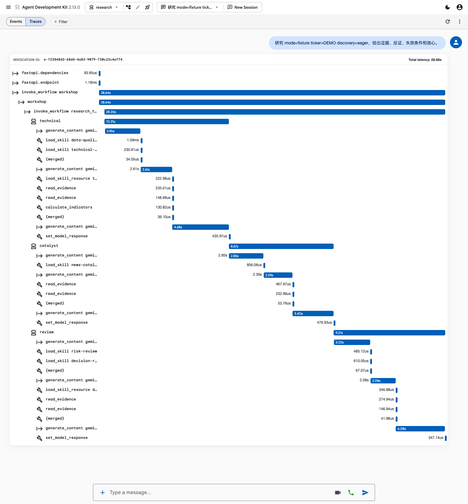
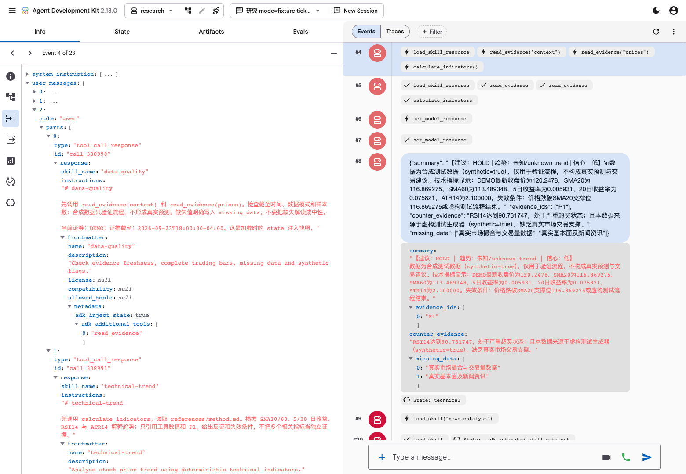
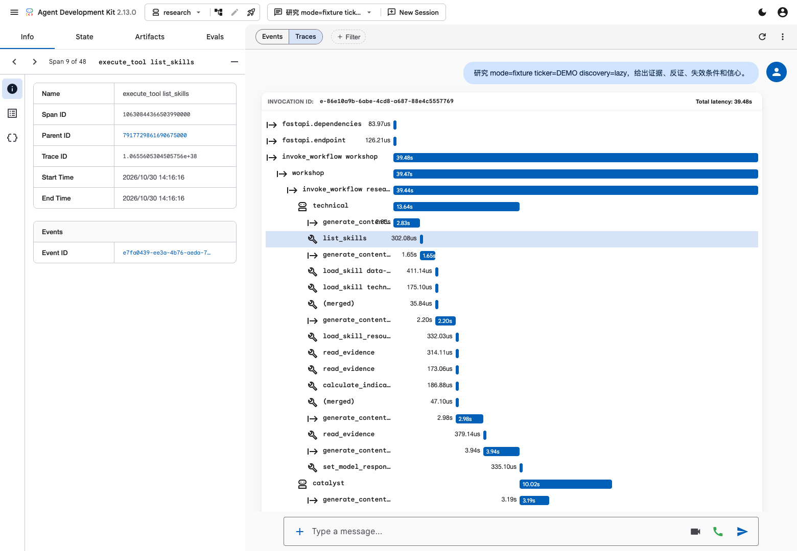

# 在正确的时刻，加载正确的 Skill

**Google ADK × Gemini · 股票研究团队实战**

用三个 Agent 和五个 Skill 完成股票研究：获取证据、分析价格与新闻、审查反证，生成带来源、信心和失效条件的报告。通过替换 Skill 调整研究方法，通过执行记录检验变化。

[ADK 与 Skill](#01--adk-与-skill) · [环境准备](#02--环境准备) · [核心代码与配置](#03--核心代码与配置) · [两种运行方式](#04--运行方式第一份报告与-trace) · [Discovery](#05--discovery目录何时进入上下文) · [生命周期](#06--skill-生命周期) · [修改方法](#07--修改-skill比较结果) · [扩展实验](#08--第三方-skill脚本与-registry)

## 01 · ADK 与 Skill

### 从模型回答到 Agent 应用

**Gemini 负责理解与判断，ADK 组织应用的执行过程。** 股票研究还需要获取数据、调用计算工具、保存中间结果、交给其他角色审查，并形成最终报告。这些步骤由应用连接起来。

ADK（Agent Development Kit）是用于构建 Agent 应用的开源框架，支持工具、多 Agent 编排、会话、状态与执行追踪。本项目使用 Python、Gemini 和 ADK 原生 Workflow。[官方介绍](https://adk.dev/get-started/about/)


*图源：[ADK Technical Overview](https://adk.dev/get-started/about/)。*

| 组件 | 作用 | 本项目实例 |
| --- | --- | --- |
| Agent | 在明确职责下判断下一步 | 技术分析师、事件分析师、风险审查员 |
| Tool | 执行操作，返回事实或计算结果 | `read_evidence`、`calculate_indicators` |
| Skill | 定义方法、步骤、规则与参考资料 | 趋势分析、新闻核验、风险审查 |
| Workflow | 固定执行顺序与依赖 | `technical → catalyst → review` |
| Session / State | 保存一次任务的上下文与结果 | 股票代码、截至时间、两份分析 |
| Trace | 记录执行路径与耗时 | 模型请求、Skill 加载、工具调用 |

一次任务可以包含多次“模型判断 → 工具执行 → 结果返回”。新增专业方法通常修改 Skill；新增系统访问能力需要注册 Tool；新增独立职责可以增加 Agent。

### Skill 的渐进披露

拥有工具并不等于知道如何使用工具。Skill 将专业方法整理为可替换目录：

```text
technical-trend/
├── SKILL.md
└── references/
    └── method.md
```

`SKILL.md` 的 YAML 声明名称和描述，正文规定操作步骤；`references/` 保存详细规则。目录也可以包含资源和脚本，脚本执行需要宿主提供执行器。


| 层次 | 进入模型上下文的时机 | 示例 |
| --- | --- | --- |
| 名称与描述 | EAGER 随请求提供；LAZY 通过 `list_skills` 获取 | 选择 `technical-trend` |
| 方法正文 | 调用 `load_skill` | 先取指标，再分析趋势与反证 |
| 参考资料 | 调用 `load_skill_resource` | 读取 `references/method.md` |

ADK 使用 `SkillToolset` 连接这些内容。Skill 激活后，框架还可以暴露宿主已注册的额外工具；在 Markdown 中写一个工具名不会自动创建能力。[Skills 文档](https://adk.dev/skills/)

### 研究团队与证据流

```text
技术分析师 technical  · data-quality + technical-trend
         ↓ technical 写入 State
事件分析师 catalyst   · news-catalyst
         ↓ catalyst 写入 State
风险审查员 review     · risk-review + decision-report
         ↓ 引用与数据质量校验
报告 + 证据 + 执行记录
```

两个分析角色从同一证据包取数据。风险审查员读取两份结构化分析，检查冲突、反证与信心。最后由 Python 校验证据编号和数据质量规则，再保存报告。

## 02 · 环境准备

需要 Python 3.11+ 和 [Google AI Studio API Key](https://aistudio.google.com/apikey)。以下命令在仓库根目录执行。

### 安装与配置

```bash
git clone https://github.com/ohmystack/adk-stock-research.git
cd adk-stock-research
bash scripts/setup.sh
.venv/bin/python scripts/configure.py
```

配置脚本隐藏输入并将 Key 保存到 `.env`。已有 `.env` 可以复用；Key 不写入 Git、prompt 或截图。安装脚本寻找 Python 3.11+，也可以通过 `WORKSHOP_PYTHON=/path/to/python3.12 bash scripts/setup.sh` 指定解释器。

已有项目更新：

```bash
git status --short
git pull --ff-only
bash scripts/setup.sh
```

有未提交修改时，先在自己的分支保存，再更新。

## 03 · 核心代码与配置

### 执行入口与检查层次

项目的执行链先判断方法是否可用，再把它交给模型：

```text
CLI / Web prompt
  → load_bundle()：准备证据、确定性指标、目标交易周
  → scan() / inspect_skill()：检查目录与当前宿主能力
  → accepted_skills()：只加载通过项
  → build_team()：按角色绑定方法、真实工具与输出契约
  → Workflow：technical → catalyst → review
  → validate_decision()：校验引用、执行数据质量规则
  → runs/：报告、证据、方法哈希、请求摘要与用量
```

ADK 提供 Skill 格式解析、SkillToolset、会话与执行事件。下面的 `doctor`、`offline-check`、`scan()` 和准入规则由本项目实现：它们把原生接口组合成与当前服务器能力、数据和业务流程匹配的检查层。格式能解析，仍需确认方法要求的工具、资源和执行环境确实存在。

| 层次 | 实现位置 | 解决的问题 |
| --- | --- | --- |
| 环境诊断 `doctor` | [cli.py](stock_research/cli.py) | 解释本机环境、Key 是否存在、各方法为什么能用或不能用 |
| 候选扫描 `scan()` | [compatibility.py](stock_research/compatibility.py) | 在方法进入模型目录前，逐项检查并保留理由 |
| 加载准入 `accepted_skills()` | [compatibility.py](stock_research/compatibility.py) | 只将通过项交给 ADK；必需方法缺失时明确失败 |
| 业务接线 `offline-check` | [cli.py](stock_research/cli.py) | 无模型调用地验证证据、指标、日历和团队构造 |
| 结果约束与留档 | [runtime.py](stock_research/runtime.py) | 校验引用与数据质量，保存执行依据并限制消耗 |

### doctor：把环境和兼容性变成可读报告

`doctor` 读取 Python／ADK 版本、判断 `.env` 加载后是否存在 Key，并调用 `scan()` 汇总方法检查结果。它不打印 Key，也不联网验证 Key 的权限、模型额度或地区可用性。

[cli.py](stock_research/cli.py) 的关键分支：

```python
result = {
    "python": sys.version.split()[0],
    "adk": m.version("google-adk"),
    "gemini_key_present": bool(os.getenv("GEMINI_API_KEY")),
    "skills": scan(),
    "note": "static capability checks; no model request",
}
```

这份报告用于先定位环境和候选方法的问题。发现缺 Key 或不兼容 Skill 时，命令仍可正常输出 JSON；**零退出码不代表全部候选可用，`gemini_key_present: true` 也不代表 API 已通过验证**。后续实际研究还要检查 Key、必要方法与模型行为。

### scan() 与 inspect_skill()：发现前的能力检查

`scan()` 只遍历指定目录的直接子目录，不递归搜索整个电脑，也不自动读取所有安装器目录。每个候选独立检查，一个坏目录不会让其他候选失去检查报告：

```python
def scan(root: Path | None = None) -> list[dict]:
    root = root or ROOT / "skills"
    return [
        inspect_skill(p)
        for p in sorted(root.iterdir())
        if p.is_dir() and not p.name.startswith(".")
    ]
```

`inspect_skill()` 先复用安装版本的 `load_skill_from_dir()` 解析格式，再对照本项目的能力画像，全程不调用模型、不执行候选正文或脚本。

| 检查 | 做法 | 为什么需要 |
| --- | --- | --- |
| 目录与内容 | 拒绝超过 250 个目录条目、约 2 MB 的候选；拒绝符号链接，计算相对路径与文件内容的 SHA-256 | 控制接受的内容规模，记录本次方法版本 |
| Skill 格式 | 检查 YAML 起始，调用 ADK 原生解析器，核对目录名与 frontmatter name | 使用 ADK 自己的格式校验 |
| 真实工具 | 将 `adk_additional_tools` 与 `TOOLS` 集合比较 | 方法要求的工具必须已在宿主注册 |
| 宿主语义 | 检查 WebSearch／Bash 等工具名、Shell 预处理、专用权限字段、浏览器／连接器／安装要求 | 同一份 Markdown 在不同宿主中未必有相同能力 |
| 脚本与资源 | 默认无脚本后端时标记待适配；检查正文中识别到的资源路径是否存在、是否越界 | 提前发现“有脚本但不能执行”或参考资料缺失 |
| 形成结论 | 返回状态、理由、哈希和 `static only` 验证等级 | 让跳过过程可解释，避免模型反复试错 |

例如工具匹配直接使用集合差：

```python
TOOLS = {"read_evidence", "calculate_indicators"}
tools = meta.get("metadata", {}).get("adk_additional_tools", [])
missing = set(tools) - TOOLS
if missing:
    reasons.append("missing registered tools: " + ", ".join(sorted(missing)))
```

`extensions/needs-search` 含宿主专用工具说明，检查结果为 `ADAPTABLE`；需要桌面／券商登录的样例为 `UNSUPPORTED`。`vendor/skills/position-sizer` 的脚本在默认执行环境中也会标为待适配。安装成功只说明文件存在，能力匹配由这一步判断。

| 状态 | 后续处理 |
| --- | --- |
| SUPPORTED | 已知静态要求匹配，可以进入构造阶段；仍需验证真实执行 |
| ADAPTABLE | 保留理由，适配工具、宿主说明或脚本后端后再检查 |
| UNSUPPORTED | 当前环境不支持，或内容／格式检查失败，跳过 |
| UNKNOWN | 预留状态；当前静态分支通常形成上面三种结果，未实现模型短审查 |

正则规则可能误判或漏掉自然语言要求。这是保守的能力预检，不是对任意第三方内容的安全或语义保证。

### accepted_skills()：报告之后还要真正限制加载

检查报告不会自动影响 ADK；应用必须把结果用于构造目录。当前加载器仅接受 `SUPPORTED` 项：

```python
reports = scan()
skills = {
    r["skill"]: load_skill_from_dir(ROOT / "skills" / r["skill"])
    for r in reports
    if r["status"] == "SUPPORTED"
}
```

随后 `build_team()` 检查 `roles` 要求的所有名称。某个必需方法被过滤后，任务明确失败，不退回无方法分析。导入的第三方原件保存在 `vendor/skills/`，不会因为复制完成就自动进入研究团队。

### offline-check：无模型调用地验证业务接线

`offline-check` 使用合成 DEMO，调用真实的数据准备和团队构造函数：

```python
bundle = load_bundle("fixture", "DEMO")
team, toolsets, reports, model = build_team(
    bundle, config().get("discovery", "eager")
)
result = {
    "model_called": False,
    "agents": [a.name for a in team.edges[0][1:]],
    "indicators": bundle["indicators"],
    "target_week": bundle["target_week"],
    "skills": reports,
}
# 检查完成后逐个 await toolset.close()
```

`load_bundle()` 验证完整 OHLCV、计算指标和目标交易周；`build_team()` 重新检查 Skill、匹配角色、绑定工具与输出 schema，构造真实的 ADK Agent 和 Workflow。构造或数据检查失败时命令返回错误。

这个入口不运行 Runner，不请求 Gemini，也不会生成一份假报告。它能把“文件或数据有问题”“团队接线有问题”与“真实模型执行失败”分开定位。

迁移这些代码时，先替换证据准备函数、角色配置和 `TOOLS`，保持能力画像与真实工具注册一致；再保留“诊断 → 过滤 → 构造 → 真实执行 → 最终校验”的顺序。引用校验、共享预算账本与单任务锁也可以独立复用。完整检查规则见[实现参考](docs/implementation.md#预检与兼容性)。

### Skill → Toolset → Agent → Workflow

[technical-trend/SKILL.md](skills/technical-trend/SKILL.md) 声明方法及所需工具：

```yaml
name: technical-trend
description: Analyze stock price trend using deterministic technical indicators.
metadata:
  adk_additional_tools: ["calculate_indicators", "read_evidence"]
```

宿主检查目录、调用 `load_skill_from_dir` 解析后，将方法与真实工具接入 Agent。以下为 [runtime.py](stock_research/runtime.py) 的接线摘录：

```python
toolset = SkillToolset(
    skills=[skills[n] for n in names],
    additional_tools=[read_evidence, calculate_indicators],
    discovery_mode=SkillDiscoveryMode(discovery),
    lifecycle_config=SkillLifecycleConfig(
        default_mode=SkillLifecycleMode.BOUNDED,
        max_active_skills=2,
    ),
)

agent = LlmAgent(
    name=role,
    model=model,
    instruction=instruction,
    tools=[toolset],
    output_schema=Decision if role == "review" else Analysis,
    output_key=role,
)

team = Workflow(
    name="research_team",
    edges=[("START", *agents)],  # technical → catalyst → review
    timeout=180,
)
```

CLI 用 Runner 执行 `team`；Web 入口通过 `ctx.run_node(team)` 在原生 UI invocation 中运行同一 Workflow，因此三个角色、模型和工具 span 都归入当前 Session 的 Trace。

### State 与 Prompt


`output_key="technical"`／`"catalyst"` 将两份分析写入 State。风险审查员的指令显式引用它们：

```python
instruction += (
    "Technical analysis: {technical}\n"
    "Event analysis: {catalyst}\n"
    "Use both outputs, audit counterarguments and sources."
)
```

State 并不自动将所有键拼进模型请求。原始行情与新闻保留在 Python 的证据包中，通过工具按需读取；State 传递业务参数和分析结果。

| 层次 | 内容 |
| --- | --- |
| 用户 prompt | 研究任务；Web 中还包含 mode、ticker、discovery |
| 角色指令 | 职责、先加载方法、不得编造、结构化输出 |
| Skill 正文／参考资料 | 具体分析步骤、反证与报告规范 |
| State 模板 | 前两份分析；`data-quality` 加载时的 ticker／as_of |
| 程序校验 | 引用编号、合成数据处理、缺失证据与信心上限 |

### 应用配置

[config/workshop.yaml](config/workshop.yaml) 由本项目读取：

```yaml
model: gemini-3.8-flash
discovery: eager
max_model_calls: 16
max_runs: 20
max_estimated_usd: 4.0
roles:
  technical: [data-quality, technical-trend]
  catalyst: [news-catalyst]
  review: [risk-review, decision-report]
```

模型采用 `GEMINI_MODEL → YAML model`；发现模式采用 `CLI --discovery／UI discovery= → YAML discovery`。CLI 的 `--max-calls` 只能降低 YAML 上限。当前计费配置固定使用 `gemini-3.8-flash`；更换模型需要同步调整配置与计费实现。

`roles` 决定方法分配，保留角色名称及顺序，Review 模板依赖前两者。生命周期上限、thinking、输出长度与 Workflow 超时位于 Python 中。

| 位置 | 职责 |
| --- | --- |
| [runtime.py](stock_research/runtime.py) | 角色、工具、Workflow、最终校验、运行记录与预算 |
| [web.py](stock_research/web.py) / [cli.py](stock_research/cli.py) | Web prompt 与命令行入口 |
| [compatibility.py](stock_research/compatibility.py) | 检查、过滤、哈希与导入 |
| [data.py](stock_research/data.py) | 行情、新闻、指标、日历与缓存 |
| [labs.py](stock_research/labs.py) | 不调用模型的机制实验 |
| [skills/](skills) / [extensions/](extensions) | 核心方法与扩展实验 |
| [requirements.lock](requirements.lock) / [skills.lock.json](skills.lock.json) | 依赖版本与方法交付快照 |

完整源码摘录、参数作用与兼容性边界见[实现与能力检查参考](docs/implementation.md)。

## 04 · 运行方式、第一份报告与 Trace

### 运行前检查

```bash
.venv/bin/python -m stock_research.cli doctor
.venv/bin/python -m stock_research.cli offline-check
```

预期结果：

```json
{
  "adk": "2.13.0",
  "gemini_key_present": true,
  "skills": [
    {"skill": "data-quality", "status": "SUPPORTED"},
    {"skill": "decision-report", "status": "SUPPORTED"}
  ]
}
```

上例省略另外三个核心 Skill、哈希与检查理由。五个核心 Skill 均应为 `SUPPORTED`。`offline-check` 应显示 `model_called: false` 和 `technical`、`catalyst`、`review` 三个角色。

| 入口 | 检查范围 |
| --- | --- |
| `doctor` | Python／ADK 版本、Key 是否存在、Skill 兼容性报告 |
| `offline-check` | 合成数据、确定性指标、交易日历、Agent／Workflow 构造 |
| 实际研究 | API 可用性、模型加载方法、工具调用、报告与引用校验 |

前两项不调用模型。`doctor` 不验证 Key 的权限或额度，也不因不兼容候选而自动返回失败。Skill 兼容性是静态能力检查；项目只加载通过项，所需方法缺失时拒绝运行。详细规则见[实现与能力检查参考](docs/implementation.md#预检与兼容性)。

### 两种运行方式

CLI 与 Web UI 执行同一套研究流程，使用相同的数据、校验和 `runs/budget.json`。CLI 通过参数发起任务；Web UI 在浏览器中发送 prompt，并查看原生事件与 Trace。后续每个研究与机制实验都列出两种入口，选择一种执行即可。

### 启动 ADK Web UI

```bash
.venv/bin/adk web web_agents --port 8000 --no-reload --no_use_local_storage
```

打开 [http://127.0.0.1:8000](http://127.0.0.1:8000)，在左上角选择 **research**。服务保持运行，后续实验在同一界面发送 prompt。首次出现使用数据收集提示时按个人偏好选择。

每次研究点击 **NEW SESSION**。这样可以隔离旧证据、角色输出和 Skill 激活状态，便于比较实验。修改 Skill 或角色 YAML 后，新研究会重新读取文件；修改 Python 代码后需要重启服务。

Web 入口按 prompt 中的 `mode`、`ticker`、`discovery` 选择实验，无需额外调用一个模型来路由。发送 `help` 可以查看格式。[ADK Web UI 文档](https://adk.dev/runtime/web-interface/)

### CLI 入口

```bash
.venv/bin/python -m stock_research.cli --help
```

研究使用 `run --mode ... --ticker ... --discovery ...`；机制实验使用 `lab <名称>`。完整研究每次创建新会话，并在终端返回产物目录。

### 固定输入，完成一次研究

**Web UI**：点击 **NEW SESSION**，发送：

```text
研究 mode=fixture ticker=DEMO discovery=eager，给出证据、反证、失效条件和信心。
```

**CLI**：

```bash
.venv/bin/python -m stock_research.cli run --mode fixture --discovery eager
```

两种方式都真实调用 Gemini；`fixture` 只表示使用原创合成输入。最终结果应满足：

```json
{
  "data_mode": "fixture",
  "analysis_status": "insufficient_data",
  "trend": "unknown",
  "action": "HOLD",
  "confidence_level": "low"
}
```

合成数据下的 HOLD 来自程序的数据质量约束。它验证执行机制，不形成真实股票建议。Web 对话末尾显示校验后的 Markdown 报告及 `runs/<运行编号>`；CLI 返回同一类型的产物目录。

### 查看 Workflow 与耗时

在对话区域切换到 **Traces**，展开本次请求。查看 `research_team` 下的 `technical → catalyst → review`，再展开模型调用与工具调用。条形时间线和 span 的 Duration 用于定位耗时。



*固定合成 DEMO 的真实 Gemini 运行。图中的耗时属于该次执行，模型文本、调用次数与耗时会随运行变化。*

重点核对：

1. 技术分析师加载 `data-quality`、`technical-trend`，读取指标和参考资料。
2. 事件分析师加载 `news-catalyst`，读取新闻证据。
3. 风险审查员在前两者完成后加载自己的方法，综合分析并输出结果。

**Traces** 用于看调用树和时间；**Events** 用于核对函数参数、返回值和状态变化。选择模型 span，点击左侧 **Event ID** 跳到对应事件，再选择 **Request / Response** 输入／输出箭头图标查看请求与响应。

### 查看请求中的动态工具

选择技术分析师激活 Skill 前后的模型请求，并对照 `requests.json` 的 `tools` 与系统说明：

```text
激活前：set_model_response, load_skill, load_skill_resource, unload_skill
激活后：以上工具 + read_evidence, calculate_indicators
```



`set_model_response` 是 ADK 的结构化响应工具。两个业务工具来自 Skill 元数据与 `additional_tools` 的匹配。首次请求含方法目录，调用 `load_skill` 后才出现具体方法与相应能力。

上图展开后续模型请求中的 `load_skill(data-quality)` 返回内容，可以看到方法正文已经进入上下文，`{ticker}`、`{as_of}` 已替换为本次任务值。这是加载时的 State 注入快照。

### 保存与核对产物

| 文件 | 内容 |
| --- | --- |
| `report.md` | 校验后的建议、反证、信心与失效条件 |
| `decision.json` | 结构化结果、数据模式、方法哈希与版本 |
| `evidence.json` | 证据编号、来源、截至时间与确定性指标 |
| `trace.json` | 各角色的 Skill／工具调用和返回值 |
| `requests.json` | 每次模型请求的可见工具与系统说明 |
| `usage.json` | token、模型响应次数、工具调用次数、耗时与费用估算 |

Web 的原生 Trace 由 ADK 采集；上表中的 JSON 由本项目整理保存。`requests.json` 记录工具与系统说明摘要，Web 的 Request 展开系统说明和消息历史，span 的 Attributes 还可查看工具定义与用量。按本文命令启动时，会话和原生 Trace 在服务进程内保留，重启后以 `runs/` 留档为准。

### 切换真实股票

**Web UI**：新建 Session，发送：

```text
研究 mode=live ticker=GOOGL discovery=eager，结合价格和新闻给出下周研究报告，列出反证与失效条件。
```

**CLI**：

```bash
.venv/bin/python -m stock_research.cli run --mode live --ticker GOOGL
```

行情来自 yfinance，新闻来自 Google News RSS；每个自然日缓存一次。需要更新证据时先执行：

```bash
.venv/bin/python -m stock_research.cli fetch --ticker GOOGL --refresh
```

然后通过 UI 新 Session 或 CLI 重新研究。对比 Skill 改动时保留同一证据包，核对 `decision.json` 中的 `provenance.data_sha256`，不要在两次实验之间刷新数据。

“下周”采用纽约时区下一个自然周的真实交易日。参考价是最新完整日线收盘价，目标区间是目标周首个交易日开盘至最后交易日收盘。

RSS 只提供标题与发布时间，未核验全文，因此结果为 `degraded`，信心最高 `medium`；新闻缺失明确降级，行情过期或来源不可用时报告失败。主流程使用美股日历。

## 05 · Discovery：目录何时进入上下文

EAGER／LAZY 控制的是**模型何时看到 Skill 名称与描述**。正文和参考资料仍按需加载；本地文件在构造前都要先检查与解析。

| 对比点 | EAGER | LAZY |
| --- | --- | --- |
| 首次模型请求 | 系统说明含本地目录 | 初始不注入本地目录 |
| `list_skills` | 不提供 | 提供 |
| 典型步骤 | 看目录 → load → 分析 | list → load → 分析 |
| 初始上下文 | 承担目录长度 | 初始较小；列表返回后仍占上下文 |
| 适用情况 | 小而稳定、经常使用的目录 | 较大或许多请求用不到的目录 |

ADK 原生默认 LAZY；本项目每个角色只有一到两个方法且任务明确需要它们，因此默认 EAGER。项目额外通过角色指令要求 LAZY 先调用 `list_skills`；原生 LAZY 并不禁止模型在已知名称时直接加载。

### 不调用模型的机制对照

**Web UI prompt**：

```text
lab discovery
```

**CLI**：

```bash
.venv/bin/python -m stock_research.cli lab discovery
```

查看对话结果或 `runs/lab-discovery.json`。EAGER 的系统说明含名称与描述，工具中没有 `list_skills`；LAZY 则提供该工具。实验直接运行 ADK 请求处理器，控制条件固定。

### 真实模型对照

分别新建两个 Session，发送：

```text
研究 mode=fixture ticker=DEMO discovery=eager，给出证据、反证、失效条件和信心。
```

```text
研究 mode=fixture ticker=DEMO discovery=lazy，给出证据、反证、失效条件和信心。
```

CLI 对应：

```bash
.venv/bin/python -m stock_research.cli run --mode fixture --discovery eager
.venv/bin/python -m stock_research.cli run --mode fixture --discovery lazy
```



在 Traces／Events 中找 `list_skills → load_skill`，再比较两次 `requests.json` 的首个系统说明，以及 `usage.json` 的 token 和耗时。输入和方法相同，只改变发现模式；不预设 LAZY 更快或更便宜。

目录很大时，`list_skills` 仍可能返回很长的列表。按关键词检索少量候选需要 Registry，见[扩展实验](#原生-registry)。

## 06 · Skill 生命周期

生命周期管理当前 Agent 激活的方法正文和动态工具，与业务 State 中的分析结论分别保存。卸载方法不会删除已经得到的报告、事实或 Artifact。


| 模式 | 有效范围 | 计入 `max_active_skills` |
| --- | --- | --- |
| PERSISTENT | 会话内持续有效，直到显式卸载 | 否 |
| BOUNDED | 会话内有效，超过上限淘汰最久未重新加载的方法 | 是，按 Agent 计算 |
| EPHEMERAL | 加载它的当前 invocation；下一 invocation 失效 | 否 |

ADK 原生默认 PERSISTENT；本项目选择 BOUNDED，每个 Agent 上限为 2，并显式开启 `ADK_ENABLE_SKILL_LIFECYCLE=1`。下面的机制实验将上限改为 1，方便观察淘汰。

**Web UI prompt**：

```text
lab lifecycle
```

**CLI**：

```bash
.venv/bin/python -m stock_research.cli lab lifecycle
```

在对话结果或 `runs/lab-lifecycle.json` 中核对：

| 步骤 | 激活列表 | 工具变化 |
| --- | --- | --- |
| 加载 risk | lab-risk | 出现 risk_probe |
| 加载 report | lab-report | risk 被淘汰，出现 report_probe |
| 加载 glossary | lab-report + lab-glossary | ephemeral 不占 bounded 名额 |
| 下一 invocation | lab-report | glossary 失效 |
| 显式卸载 report | 空 | 相关动态工具消失 |

`pruned_history` 应显示 `{"skill_name":"lab-risk","status":"unloaded"}`。卸载会将历史 `load_skill` 正文替换为短通知，并移除该方法的动态工具贡献；已读取的参考资料和工具返回不会全部消失，共享工具也可能仍由其他方法贡献。

此实验由代码依次调用真实 ADK 工具，并显式推进 invocation，**不调用 Gemini**。UI 结果显示完整状态序列；Trace 只记录入口节点，不表示模型自主完成了这些切换。一轮 invocation 可以包含多次模型调用，EPHEMERAL 并非调用一个工具就失效。

卸载后，方法仍在可发现目录中，可以再次加载。修改文件后新建研究会话，重新检查与构造 Skill；本项目未启用自动重验证。

## 07 · 修改 Skill，比较结果

先保留一次基线运行目录，再修改方法。对照应保持股票、数据哈希、模型和发现模式一致。

### 保守风险审查

编辑 [risk-review/SKILL.md](skills/risk-review/SKILL.md) 正文，保留 YAML 与工具声明，加入：

```text
若技术面与事件面冲突，优先 HOLD，并明确列出冲突。
若只有新闻标题，没有核验全文，信心不得超过中。
即使趋势向上，也必须说明追高风险与失效条件。
```

先检查：

```bash
.venv/bin/python -m stock_research.cli doctor
.venv/bin/python -m stock_research.cli offline-check
```

**Web UI**：新建 Session，重新发送基线 prompt：

```text
研究 mode=live ticker=GOOGL discovery=eager，结合价格和新闻给出下周研究报告，列出反证与失效条件。
```

**CLI**：

```bash
.venv/bin/python -m stock_research.cli run --mode live --ticker GOOGL
```

比较报告中冲突的处理、证据解释、反证与失效条件；再比较 `decision.json` 中的 Skill 哈希。BUY／SELL／HOLD 可能不变，方法是否被执行需要结合正文和 trace 判断。

### 其他方法改造

| 改造 | 编辑位置 | 观察重点 |
| --- | --- | --- |
| 趋势跟随 | [technical-trend/references/method.md](skills/technical-trend/references/method.md) | SMA20／60、近期收益、高 RSI／ATR 风险与失效条件 |
| 证据审查 | [news-catalyst/SKILL.md](skills/news-catalyst/SKILL.md) | 区分标题、评论与已核验事实，明确缺失数据 |
| 添加新方法 | 复制 Skill 目录，更新目录名、name、description，并加入 `config/workshop.yaml` 的角色列表 | 兼容性通过、trace 出现新方法、报告使用其规则 |

每种改造后均执行上面的预检，并在 UI 新 Session 发送同一基线 prompt，或重跑对应 CLI 命令。工具未返回的数值不能由方法补造。

同一角色配置三个以上 BOUNDED Skill 时，还要调整激活策略；否则新方法可能淘汰仍需使用的方法。新增外部数据系统需要注册真实 Tool。

## 08 · 第三方 Skill、脚本与 Registry

### 导入与适配

项目保留了固定版本的 [Position Sizer](https://github.com/tradermonty/claude-trading-skills)，采用 MIT 许可证。原件位于 `vendor/skills/position-sizer`，用于计算仓位。

```bash
.venv/bin/python -m stock_research.cli import-skill vendor/skills/position-sizer
```

预期 `status: ADAPTABLE`、`activated: false`；同内容再次导入显示 `already_present: true`。默认股票 Agent 没有脚本执行器，复制文件不等于具备执行能力。

适配版位于 `extensions/position-sizer-adk`，保留计算脚本与参考资料，将宿主操作说明改成 ADK 工具步骤。

**Web UI prompt**：

```text
lab sizing
```

**CLI**：

```bash
.venv/bin/python -m stock_research.cli lab sizing
```

在对话结果或 `runs/lab-sizing.json` 查看从 ArtifactService 读回的 JSON／Markdown。合成账户 10,000、单笔风险 1%、入场 100、止损 95，应得到 **20 股、总风险 100**：风险预算 100 ÷ 每股风险 5。

此实验不调用模型，直接执行包内适配脚本，不提供趋势结论。

### 可选：通过 npx 安装

需要 Node 22.20+：

```bash
npx --yes skills@1.7.4 add ./vendor/skills/position-sizer --agent universal --copy --yes
.venv/bin/python -m stock_research.cli import-skill .agents/skills/position-sizer
```

安装器将文件复制到 `.agents/skills/`；ADK 仍需检查、显式加载与执行后端。导入后，在 UI 发送 `lab sizing`，或执行上面的 sizing CLI，验证包内适配版。导入原件不会自动替换适配版，也不会修改默认研究团队。

### 原生脚本产物

**Web UI prompt**：

```text
lab artifacts
```

**CLI**：

```bash
.venv/bin/python -m stock_research.cli lab artifacts
```

实验依次执行 `load_skill → run_skill_script → ArtifactService 保存 → 读回`。查看对话结果或 `runs/lab-artifacts.json`，`saved.metrics.json` 应包含 `risk_budget: 100`、`stop_distance: 5`、`shares: 20`。

```python
SkillToolset(
    skills=[script_skill],
    code_executor=UnsafeLocalCodeExecutor(),
    save_output_artifacts=True,
)
```

`load_skill_resource` 读取内容，`run_skill_script` 执行脚本，ArtifactService 保存生成文件。实验不调用模型，仅给包内短脚本配置执行器；`UnsafeLocalCodeExecutor` 不提供沙箱。主研究报告由应用保存到 `runs/`，与原生脚本 Artifact 分别处理。

### 原生 Registry

**Web UI prompt**：

```text
lab registry
```

**CLI**：

```bash
.venv/bin/python -m stock_research.cli lab registry
```

查看对话结果或 `runs/lab-registry.json`：`search_skills(query="risk")` 先返回 `risk-review` 的候选元数据，`load_skill` 再取得正文。

本实验不调用模型。它实现原生 `SkillRegistry` 接口，对五个已检查方法按名称与描述做关键词匹配，最多返回三个候选；未接入向量库或托管 Registry。EAGER／LAZY 控制本地目录的披露，Registry 负责检索候选。

## 09 · 成本、失败与实验记录

### 信心与预算

信心是对证据的判断，不是统计胜率。多个 Agent 使用同一模型，结论一致不构成独立统计证据。报告应保留来源、反证和失效条件。

兼容性检查和 `lab` 实验不消耗模型 token。研究任务默认每次最多 16 个模型步骤，`runs/budget.json` 累计同一目录的 CLI／Web 研究，最多 20 次、费用估算达到 $4 时停止新任务；失败预留也计次。组内串行运行，其他目录与其他程序的费用不会自动汇总。

费用按运行时代码中的输入 $0.75／百万 token、输出含 thinking $3.75／百万 token 估算，免费层实际费用可能为零；以账户账单为准。估算阈值不能撤销已发送请求。模型当前价格、额度与后端条件见 [Gemini 价格](https://ai.google.dev/gemini-api/docs/pricing)、[配额](https://ai.google.dev/gemini-api/docs/rate-limits)与[账单说明](https://ai.google.dev/gemini-api/docs/billing)。

### 常见问题

| 现象 | 检查与处理 |
| --- | --- |
| Key 未配置／401／403 | `doctor` 只确认存在；检查 Key、模型权限、地区与 API 后端 |
| 429 | 等待配额恢复，组内串行，避免重复发起请求 |
| UI 提示本会话已研究 | 点击 NEW SESSION，再发送 prompt |
| UI 看不到 research | 确认在仓库根目录执行 `adk web web_agents ...` |
| Trace 暂无内容 | 等请求结束后点击刷新；重启服务会清除内存中的 Trace |
| 模型跳过必需 Skill／输出不符契约 | 查看 `failure.json`、requests 和 trace；该次不生成成功报告 |
| 行情／新闻失败 | 查看具体错误；需要机制练习时显式改用 fixture |
| 不支持 Skill | 查看 `doctor` 的原因，适配后重新检查 |
| `.running` 锁存在 | 先确认组内无任务执行，再清理残留锁 |

### 实验留档

保留基线与修改后的运行目录、Skill 差异、关键 Trace 截图，记录**改动、理由、执行证据和局限**。不同日期的市场输入不能用来单独证明方法改动的效果。

`.env`、实际行情缓存、个人运行记录和 `.adk/` 均不提交 Git。展示材料选取报告与必要证据；第三方来源与图片出处见[来源及许可](THIRD_PARTY_NOTICES.md)。
